# 🧠 Awesome AI Education & LLM Architecture 🚀

  <strong>The Definitive Directory of SaaS Platforms &amp; Open-Source Repositories for Building LLMs from Scratch, Transformer Internals, and Deep Learning Engineering</strong>

<!-- Badges Header -->

  
  
  
  
  
  
  

  <a href="#-sector-overview--market-dynamics">Market Dynamics</a> •
  <a href="#-saashosted-platforms">SaaS Platforms</a> •
  <a href="#-open-source-github-projects">Open-Source Repos</a> •
  <a href="#-how-to-contribute">Contributing</a> •
  <a href="#-support--sponsor">Support</a> •
  <a href="#-star-history">Star History</a>

---

## 📌 Overview & SEO Summary

Welcome to the **Awesome AI Education & Large Language Model (LLM) Architecture Ecosystem**.

Whether you are an AI engineer, machine learning researcher, or software developer transitioning into modern generative AI, this curated repository is designed to bridge the gap between high-level prompt engineering and low-level model construction. 

### 🔍 Key Focus Topics:
* 🔬 **Building LLMs From Scratch**: From raw text preprocessing, BPE tokenization, embedding matrices, multi-head self-attention, and residual MLP blocks to full GPT pretraining.
* ⚡ **Transformer Internals**: RoPE (Rotary Position Embeddings), KV caching, FlashAttention, RMSNorm, SwiGLU, and grouped-query attention (GQA).
* 🎯 **Fine-Tuning & Alignment**: SFT (Supervised Fine-Tuning), LoRA/QLoRA parameter-efficient adaptation, DPO (Direct Preference Optimization), and RLHF.
* 🏭 **Serving & Distributed Systems**: Low-latency inference engines (vLLM, Unsloth), Triton kernels, pipeline parallelism, tensor parallelism, and CUDA acceleration (llm.c).
* 🎓 **Commercial vs. Open Curriculum**: Side-by-side market evaluation of premium SaaS educational ecosystems versus community-driven open-source codebases.

---

## 📊 Sector Overview & Market Dynamics

The global **AI in Education & Technical Upskilling market** is estimated at **$6.5B – $8.5B in 2025** and projected to exceed **$10B – $11.5B by 2026**, expanding at a CAGR of ~30-36%. 

The sector displays a **bifurcated market structure**: it is **moderately concentrated at the core infrastructure and credentialing tier**—where major institutional moats, university accreditations, and cloud platform giants (Coursera, edX/2U, Pluralsight) hold entrenched distribution—while remaining **highly fragmented at the specialized application, bootcamp, and independent course layer**, where niche providers, open-source cohorts, and emerging AI tutor startups compete with low barriers to entry.

---

## 📑 Table of Contents

- [📌 Overview & SEO Summary](#-overview--seo-summary)
- [📊 Sector Overview & Market Dynamics](#-sector-overview--market-dynamics)
- [💻 SaaS/Hosted Platforms](#-saashosted-platforms)
- [🐙 Open-Source GitHub Projects](#-open-source-github-projects)
- [🤝 How to Contribute](#-how-to-contribute)
- [☕ Support & Sponsor](#-support--sponsor)
- [⭐ Star History](#-star-history)
- [⚠️ Disclaimer](#️-disclaimer)

---

## 💻 SaaS/Hosted Platforms

The table below lists leading commercial and hosted AI education platforms, sorted in descending order by company scale (valuation / annual revenue).

| 🏢 Platform | 📈 Company Scale (Valuation / Revenue) | 💳 Pricing | 🎁 Free Tier / Free Trial Limits | 📝 Description |
| :--- | :--- | :--- | :--- | :--- |
| **[O'Reilly Learning](https://www.oreilly.com/)** | ~$2.7B parent valuation (O'Reilly Media / private; ~$500M+ rev) | Starting at **$49/month** or **$499/year** (Individual) | **10-day free trial** with full platform access to books, courses, and interactive sandboxes | Premier technical library platform with books, interactive sandboxes, early-release titles, and live AI architecture events. |
| **[Pluralsight](https://www.pluralsight.com/)** | ~$1.5B–$2B recapitalized enterprise scale (~$400M–$500M ARR; acquired for $3.5B in 2021) | Starting at **$29/month** or **$299/year** (Standard Core) | **10-day free trial** with 200 hours of content access | Enterprise tech skills platform offering curated AI/ML skill assessments, guided video paths, and hands-on cloud labs. |
| **[Coursera](https://www.coursera.org/)** | ~$1.3B+ Market Cap (NYSE: COUR; ~$750M+ 2025 revenue) | Starting at **$49/month** (Coursera Plus) or **$399/year**; individual courses $49–$79/mo | **Free Audit Mode** (lifetime access to video lectures & readings for individual courses; graded assignments & certificates locked) or **7-day free trial** on Coursera Plus | University-backed AI specializations from Stanford, DeepLearning.AI, and top institutions with hands-on projects. |
| **[Udacity](https://www.udacity.com/)** | ~$800M+ valuation (acquired by Accenture in 2024; ~$120M+ rev) | Starting at **$249/month** or **$846/4-month access** (Nanodegree) | **7-day free trial** on subscription access (credit card required; full program review & project rubric preview) | Rigorous project-based Nanodegree programs in AI, LLM engineering, and autonomous systems with human code reviews. |
| **[edX](https://www.edx.org/)** | ~$800M acquisition valuation (acquired by 2U; ~$200M+ platform rev) | Free audit or **$50–$300 per course** for verified track; **$349/year** (edX Subscription) | **Free Audit Track** for course duration (access to videos, readings, and ungraded practice; certificate and graded exams excluded) | Non-profit founded academic platform delivering MIT, Harvard, and Columbia graduate-level AI and data science courses. |
| **[DataCamp](https://www.datacamp.com/)** | ~$600M+ valuation (~$100M–$150M ARR; $31M total funding) | Starting at **$13/month** billed annually ($156/yr) or **$39/month** (Premium) | **Free Forever Plan** (first chapter of every course, 7 projects, 3 code-along sessions, and daily coding challenges) | Browser-based interactive data science and deep learning coding environment with immediate feedback. |
| **[Cloud Academy](https://cloudacademy.com/)** | ~$200M+ estimated enterprise value (acquired by QA Ltd; ~$40M+ ARR) | Starting at **$39/month** or **$399/year** (Personal Plan) | **7-day free trial** (unrestricted access to all hands-on labs, courses, and cloud sandboxes) | Cloud, MLOps, and production AI training with guided cloud console sandboxes on AWS, GCP, and Azure. |
| **[DeepLearning.AI](https://www.deeplearning.ai/)** | ~$100M–$150M estimated valuation (~$50M–$75M ARR; founded by Andrew Ng) | Team plan at **$25/user/month** (10–100 seats); individual courses hosted via Coursera at **$49/month** | **100% Free Short Courses** (1–2 hour hands-on prompt and LLM developer tutorials created with OpenAI, Anthropic, AWS, Meta, etc.) | Foundational AI education provider co-designing curriculum with top AI model builders and research teams. |
| **[Springboard](https://www.springboard.com/)** | ~$80M–$100M valuation ($65M+ venture funding raised) | Starting at **$4,900 – $9,900 flat tuition** (or ~$850/month installment plans) | **Free Curriculum Preview** / 7-day money-back guarantee with introductory starter modules and syllabus consultation | 1-on-1 mentor-led intensive AI/ML engineering bootcamps with portfolio development and job placement guarantees. |
| **[fast.ai](https://www.fast.ai/)** | Independent non-profit research lab ($0 external venture equity) | **$0 (100% Free & Open Education)** | **100% Free Forever with No Limits** (complete course videos, notebooks, community forums, and book materials with no registration required) | Influential top-down practical deep learning curriculum ("Practical Deep Learning for Coders") led by Jeremy Howard. |

---

## 🐙 Open-Source GitHub Projects

The table below catalogs premier open-source repositories for self-study, LLM architectures from scratch, transformer internals, and deep learning engineering. Repositories are sorted in descending order by **GitHub Star Count**.

| 📦 Repository | ⭐ GitHub Stars | 🎯 Focus Area / Technical Highlights |
| :--- | :---: | :--- |
| **[huggingface/transformers](https://github.com/huggingface/transformers)** |  | The industry-standard library and educational resource for state-of-the-art transformer models (BERT, GPT, Llama, Gemma, Mistral) in PyTorch, TensorFlow, and JAX. |
| **[microsoft/generative-ai-for-beginners](https://github.com/microsoft/generative-ai-for-beginners)** |  | 21-lesson structured curriculum by Microsoft teaching generative AI fundamentals, prompt engineering, agentic design, and LLM application development. |
| **[rasbt/LLMs-from-scratch](https://github.com/rasbt/LLMs-from-scratch)** |  | The definitive step-by-step implementation guide for coding, training, and fine-tuning ChatGPT-like LLMs from scratch in pure PyTorch by Sebastian Raschka. |
| **[vllm-project/vllm](https://github.com/vllm-project/vllm)** |  | High-throughput, memory-efficient LLM serving and inference engine featuring PagedAttention; essential reference for serving architecture. |
| **[microsoft/ML-For-Beginners](https://github.com/microsoft/ML-For-Beginners)** |  | 12-week, 26-lesson curriculum on classical machine learning, scikit-learn, regression, classification, and neural network foundations. |
| **[mlabonne/llm-course](https://github.com/mlabonne/llm-course)** |  | Complete roadmap and curated curriculum for breaking into LLMs: mathematics, pretraining, fine-tuning (SFT, LoRA, DPO), quantization, and deployment. |
| **[dair-ai/Prompt-Engineering-Guide](https://github.com/dair-ai/Prompt-Engineering-Guide)** |  | Comprehensive repository covering prompt engineering techniques, reasoning frameworks (CoT, ReAct), alignment, and LLM evaluation papers. |
| **[UnslothAI/unsloth](https://github.com/UnslothAI/unsloth)** |  | Ultra-fast, memory-optimized open-source engine for fine-tuning LLMs (Llama 3, Mistral, Gemma, Phi) 2x-5x faster with 70% less VRAM using custom Triton kernels. |
| **[josephmisiti/awesome-machine-learning](https://github.com/josephmisiti/awesome-machine-learning)** |  | Definitive curated list of machine learning frameworks, libraries, and tools organized across dozens of programming languages. |
| **[microsoft/AI-For-Beginners](https://github.com/microsoft/AI-For-Beginners)** |  | 12-week, 24-lesson comprehensive beginner curriculum covering symbolic AI, neural networks, computer vision, NLP, and AI ethics. |
| **[karpathy/nanoGPT](https://github.com/karpathy/nanoGPT)** |  | Andrej Karpathy's minimal, clean, and hackable repository for training and fine-tuning medium-sized GPTs with DDP and torch.compile. |
| **[facebookresearch/llama](https://github.com/facebookresearch/llama)** |  | Meta AI's official open-source inference codebase and architecture reference for the Llama family of foundation models. |
| **[karpathy/llm.c](https://github.com/karpathy/llm.c)** |  | LLM training implemented in simple, raw C/CUDA without PyTorch or 245MB Python dependencies; outstanding low-level educational resource. |
| **[d2l-ai/d2l-en](https://github.com/d2l-ai/d2l-en)** |  | *Dive into Deep Learning* — interactive deep learning textbook with code, math, and discussions implemented in PyTorch, JAX, NumPy, and TensorFlow. |
| **[Hannibal046/Awesome-LLM](https://github.com/Hannibal046/Awesome-LLM)** |  | Curated collection of foundational research papers, model weights, datasets, training frameworks, and evaluation tools in LLMs. |
| **[fastai/fastbook](https://github.com/fastai/fastbook)** |  | The official companion notebooks to *Deep Learning for Coders with fastai and PyTorch*, delivering pragmatic top-down education. |
| **[karpathy/minGPT](https://github.com/karpathy/minGPT)** |  | A minimal, interpretable PyTorch re-implementation of OpenAI GPT training designed purely for educational clarity (~300 lines). |
| **[karpathy/micrograd](https://github.com/karpathy/micrograd)** |  | A tiny scalar-valued autograd engine with a small PyTorch-like neural network API, perfect for mastering backpropagation from scratch. |
| **[udlbook/udlbook](https://github.com/udlbook/udlbook)** |  | Companion Python notebooks and problem sets for Simon J.D. Prince's MIT Press textbook *Understanding Deep Learning*. |
| **[greyhatguy007/Machine-Learning-Specialization-Coursera](https://github.com/greyhatguy007/Machine-Learning-Specialization-Coursera)** |  | Complete open-source course assignments, labs, and lecture notes for Andrew Ng's updated Machine Learning Specialization. |
| **[harvardnlp/annotated-transformer](https://github.com/harvardnlp/annotated-transformer)** |  | Harvard NLP's line-by-line PyTorch implementation and pedagogical walkthrough of the seminal paper *"Attention Is All You Need"*. |
| **[srush/Tensor-Puzzles](https://github.com/srush/Tensor-Puzzles)** |  | Interactive programming puzzles for practicing tensor manipulation and low-level broadcasting in PyTorch and NumPy. |
| **[stanford-cs336/spring2024-assignment1-basics](https://github.com/stanford-cs336/spring2024-assignment1-basics)** |  | Stanford CS336 (*Language Modeling from Scratch*) assignment repository covering BPE tokenization, transformer blocks, and pretraining. |

---

## 🤝 How to Contribute

Contributions are warmly welcome! Help us keep this directory the most accurate, up-to-date guide on the internet:

1. 🍴 **Fork the repository**.
2. 🌿 **Create a descriptive branch** (`git checkout -b add-new-resource`).
3. 📝 **Add/edit entries in [`README.md`](file:///C:/Users/ishan/Documents/Projects/Awesome-AI-Education-LLM-Architecture/README.md)** (maintain table formatting, accurate pricing, free tier limits, star badges, and SEO tags).
4. 🚀 **Submit a Pull Request** with a concise description of your additions.

---

## ☕ Support & Sponsor

Thank you for exploring and utilizing the **Awesome AI Education & LLM Architecture** ecosystem! Maintaining this curated repository with up-to-date pricing, star trackers, and architectural references takes dedicated effort.

If you find this repository valuable for your learning journey or engineering work, please consider supporting the project:
* ⭐ **Star the repository** to boost visibility for other learners.
* 🍴 **Fork and share** with your peers, developer communities, and study groups.
* ☕ **Buy me a coffee / Sponsor**: Support ongoing maintenance directly via the [GitHub Sponsor Dashboard](https://github.com/sponsors/ishandutta2007).

  

---

## ⭐ Star History

---

## ⚠️ Disclaimer

- This is a **community-curated** educational guide — not exhaustive and not an endorsement of any single commercial provider.
- AI education resources cover **theoretical understanding and practical implementation**—neither replaces hands-on production engineering experience with distributed systems, GPU provisioning, and operational MLOps.
- Pricing, free tier limits, and subscription models are subject to change by their respective vendors.

---

**Made with ❤️ for AI engineers, researchers, and developers worldwide.**  
*Let's make AI Education & LLM Architecture open, accessible, and grounded from scratch.*

